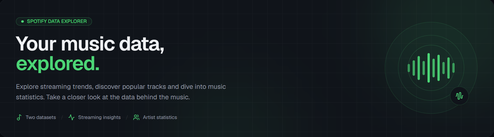

# Spotify Stats

A small data exploration project built with **Next.js**, **shadcn/ui** and Spotify datasets from Kaggle.

Explore Spotify statistics from 2023 and 2024, including tracks, artists, streams and other insights through interactive dashboards.

## Features

- Spotify statistics for 2023 and 2024.
- Overview dashboards with key metrics and charts.
- Artist rankings and individual artist pages.
- Search for artists and explore their streaming statistics.
- CSV-based data parsing without a database.

## Getting Started

Install the dependencies:

```bash
npm install
```

Start the development server:

```bash
npm run dev
```

Open [http://localhost:3000](http://localhost:3000) to view the application.

## Tech Stack

- [Next.js](https://nextjs.org/)
- [React](https://react.dev/)
- [Tailwind CSS](https://tailwindcss.com/)
- [shadcn/ui](https://ui.shadcn.com/)
- [Recharts](https://recharts.org/)
- [CSV Parse](https://www.npmjs.com/package/csv-parse)

## CSV Parsing

CSV files are parsed using [CSV Parse](https://www.npmjs.com/package/csv-parse).

The datasets are stored locally in `src/data` and loaded directly by the application.

## UI Components – shadcn/ui

**Documentation:**  
https://ui.shadcn.com/docs

**Next.js Installation:**  
https://ui.shadcn.com/docs/installation/next

Add components using:

```bash
npx shadcn@latest add [components]
```

Example:

```bash
npx shadcn@latest add sidebar breadcrumb separator
```

## Data Sets

The project uses the following publicly available Kaggle datasets:

**Most Streamed Spotify Songs 2023**

https://www.kaggle.com/datasets/nelgiriyewithana/top-spotify-songs-2023

**Most Streamed Spotify Songs 2024**

https://www.kaggle.com/datasets/nelgiriyewithana/most-streamed-spotify-songs-2024

